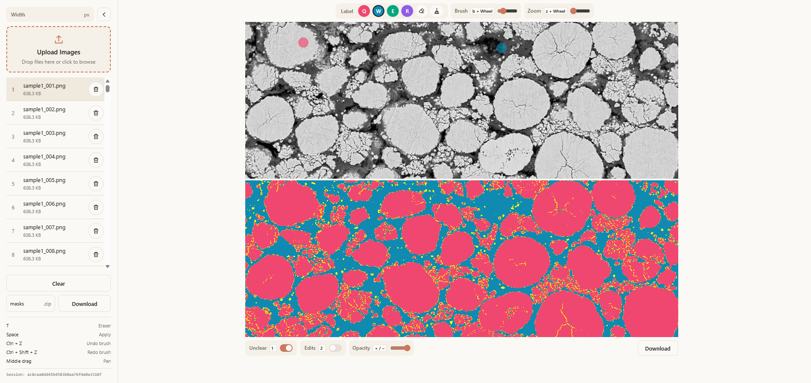

# Online Segment

Online Segment is a self-hosted tool for turning sparse brush labels into complete segmentation masks with a trainable multiscale random forest.



## Features

- Train directly from project-specific labels `0–3`.
- Process images at their original resolution or a selected working width.
- Inspect uncertain regions and manual edits before export.
- Export one mask or a full batch as lossless PNG files in a ZIP archive.
- Accelerate large batch exports with parallel CPU features and optional CUDA prediction, with automatic CPU fallback.
- Follow batch progress with percentage, remaining time, and a stop button.

## Workflow

1. Upload images and optionally enter a working width.
2. Paint at least two labels with consistent meanings across the batch.
3. Press **Space** to train and predict.
4. Review the result, correct labels, and download one mask or the full batch.

Labels `0–3` have no predefined meaning. Unpainted pixels are excluded from training and stored as `255` in drawn-mask exports.

## Shortcuts

| Key | Action |
| --- | --- |
| `Q` / `W` / `E` / `R` | Select labels `0–3` |
| `T` | Eraser |
| `Space` | Train and apply |
| `1` / `2` | Toggle unclear areas / edits |
| `B` + wheel | Brush size |
| `Z` + wheel | Zoom |
| `+` / `-` | Mask opacity |
| `Ctrl+Z` / `Ctrl+Shift+Z` | Undo / redo brush stroke |
| Middle drag | Pan |

## Configuration

- `backend/config.yaml`: model, feature, CUDA, export, and server settings.
- `frontend/config.js`: editor, label, download batching, and progress settings.

Model or feature changes require retraining. Frontend changes require a rebuild.

## Install

```bash
cd backend
pip install -r requirements.txt
```

```bash
cd frontend
npm install
```

Install a CUDA-enabled PyTorch build separately to enable GPU batch prediction.

## Run

```bash
cd frontend
npm run build
```

```bash
cd backend
uvicorn app.main:app --host 0.0.0.0 --port 8000 --workers 1
```

Run the server with one worker because sessions are process-local. Inactive temporary sessions expire after one hour.

## Credits

The trainable workflow is based on the [SAMBA paper](https://doi.org/10.21105/joss.06159) and [SAMBA Web](https://github.com/tldr-group/samba-web).
