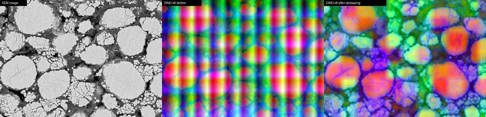
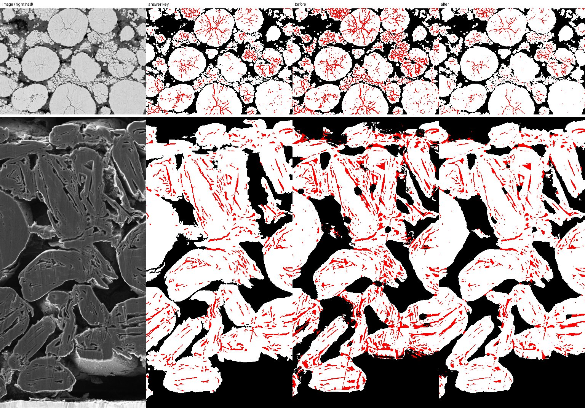
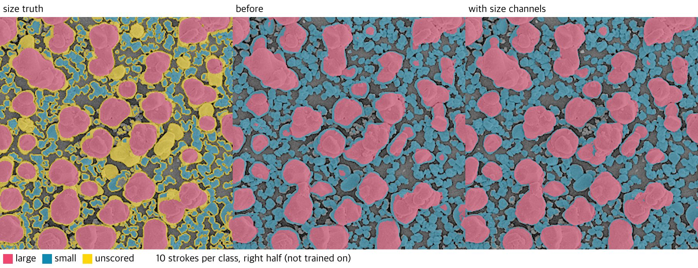

# DINOv3 multi-scale RF features

2026-10-28. The default RF input is now frozen DINOv3 ViT-B/16 tokens at several input magnifications, with the tiling artifact removed, plus the 16 image channels of the previous RF and 7 size channels. Cellpose context is off by default (`feature.cellpose: none`); CPDINO is still used for **Find regions**.

## Why

On battery SEM cross-sections the previous image-only RF separated classes mostly by brightness. Cracks and pores are both dark, so every dark line — including gaps between fine grains — was predicted as crack.

The training-free FSSDINO method ([arXiv 2602.07550](https://arxiv.org/abs/2602.07550), [code](https://github.com/hussni0997/fssdino)) shows that frozen DINOv3 features separate semantic regions well across domains. Its 16 px tokens cannot draw 2–3 px cracks directly. Two changes close that gap:

- **Upscale before encoding.** At scale `s` each token covers `16/s` original pixels. The default `[2, 4, 8]` gives 8, 4 and 2 px tokens; the coarse level keeps context and the fine level reaches crack width. Each level gets its own PCA (`feature.components`, default 8).
- **Image channels beside the tokens.** The previous RF's 16 brightness, gradient and ridge channels. Tokens are bilinearly interpolated, so these channels place edges, thin cracks and small grains exactly, and they keep pore and binder apart by brightness. With 8 PCA dims per level the trees pick them often enough; with 32 dims they were drowned out.

Tiles of `dino.tile` px overlap by `dino.overlap` px and are blended with a linear taper.

### Positional artifacts

At scales 4 and above a 512 px tile shows a small, nearly uniform patch of the original image, so DINO's tokens mostly encode where they sit in the tile. The PCA maps of those levels were dominated by stripes and checkerboards on the tile grid rather than particles and cracks. The pattern is the same in every tile, so `dino.debias` averages each in-tile position over all tiles and subtracts that mean before blending (the idea behind Denoising Vision Transformers). It needs at least 8 tiles; with fewer, the mean is mostly image content and the level is left as is.

 After debiasing, the scale-8 level shows particles, agglomerates, binder and the cracks inside particles, and DINO alone (no image channels, 30 clicks) rose from mIoU 0.391 to 0.471.

### Image-only trees

With few labels, 24 DINO dims gave the trees many noisy splits, and DINO features scored below the image-only RF. Part of the 200 trees are now grown on the image channels alone (the token columns are zeroed, and constant columns are never split on) and merged into one forest, so prediction costs the same. Averaging the two halves never fell below the image-only RF on average and kept DINO's gain with more labels; since the answer keys (below) the split is 150 token trees to 50 image-only trees. The FSSDINO class prototypes and Gram maps were tried as RF channels and dropped: with 10 clicks per class they collapsed (crack F1 ≈ 0.05), and with dense labels they leaked training labels into features.

### Size channels

On `frontend/asset/sample3.png`, large particles among many small grains, labels inside the particles separated the two sizes, but every large particle came back with a rim predicted small. A rim has the brightness, gradients and 2–8 px DINO tokens of a small grain, so no local feature tells them apart, and more labels did not help: they sit inside particles, away from the rims.

Seven size channels describe what fits inside a structure instead of its edges. Each is a grayscale opening of the luminance, smoothed with σ = `base`, by a disk of radius `round(base·2^(1+i/2))`, i = 0…6, where `base = clip(min(H, W)/512, 0.5, 8)` (radii 3–23 px on sample3). Where a disk fits inside a bright structure, its pixels keep about their own brightness out to the rim; smaller structures drop to their surroundings. A large particle's rim thus keeps its particle's size channels, while a small grain loses the wide ones. The count stays 7 at every image size, so features of differently sized images stack. They take 0.2 s at 768 px.

The image-only trees now grow on the image and size channels; the token trees keep the image channels and DINO tokens (with `feature.kind: image`, the image channels alone). Size channels in the token trees lowered the sample1 four-class mIoU by 0.006–0.017. The size trees are a RandomForest with best-split thresholds (`max_features=0.3`, no bootstrap) rather than ExtraTrees: one best cut between the labelled sizes keeps rims with their particle, whereas random cuts left mixed nodes that the edge channels finished, and there a large particle's rim again looked like a small grain. At the app's limit of 10 000 labelled pixels per class it fits in 0.5–0.7 s, against 0.1 s for the ExtraTrees.

Rejected:

- Smoothing class probabilities or DINO features with an edge-preserving domain transform, also restricted to the foreground: it leaked across touching small grains.
- Opening-by-reconstruction profiles: they leaked along bright paths between touching particles.
- Top-hats, closings, openings of a σ = 3 image, and dividing each opening by the fraction that survives it.
- Bootstrapped size trees with √n features per split fit 3× faster but left more rim errors (sample3 rim error 0.10 vs 0.06, mIoU 0.939 vs 0.949). Capping their training pixels per class lowered sample1 with dense labels (mIoU 0.780 → 0.770 at 2 000 per class).

### Answer keys: rare classes and blurred edges

2026-10-29. `eval/evaluate_keys.py` scores the hand-checked answer keys `frontend/asset/sampleN_mask.png` (table below) at the app's default width of 768: left half labelled with 10 or 30 clicks or strokes per class, right half scored, mean of the four settings.

Two errors dominated. Crack was over-predicted: on sample1 the RF called about twice as many particle pixels crack as there are true crack pixels. Balanced class weights train every class as equally common, while crack covers 5–6 % of the image. And 57–92 % of all errors lay within 2 px of a class edge, because tokens are interpolated and blur class edges over a few pixels. Three changes, all at prediction:

- **Rebalance.** Class probabilities are multiplied by the square root of each class's share in the image's own prediction (relative to an even share) and renormalised: halfway, in log space, to the image's class mix. The full prior correction (EM, Saerens et al. 2002) erased cracks entirely and lowered sample3, where the classes are already even.
- **Refine.** A guided filter (radius 2 px, ε = 1e-4) of each class probability with the luminance channel as guide moves class edges onto brightness edges, so thin cracks stay thin and bright particle rims stay particle.
- **Tree split.** 150 token trees and 50 image/size trees instead of 100 and 100.

| Seed | Features | Sample 1 | 2 | 3 | 4 | Mean | Crack IoU 1 / 4 | Crack F1 (2 px) 1 / 4 |
|---|---|---:|---:|---:|---:|---:|---:|---:|
| 0 | DINO (before) | 0.638 | 0.592 | 0.719 | 0.616 | 0.641 | 0.310 / 0.421 | 0.742 / 0.778 |
| | DINO (now) | 0.665 | 0.613 | 0.733 | 0.677 | 0.672 | 0.321 / 0.507 | 0.747 / 0.836 |
| 1 | DINO (before) | 0.622 | 0.597 | 0.719 | 0.619 | 0.639 | 0.280 / 0.408 | 0.710 / 0.768 |
| | DINO (now) | 0.640 | 0.631 | 0.728 | 0.700 | 0.675 | 0.266 / 0.514 | 0.685 / 0.850 |

Each change alone, seed 0 (mean mIoU): rebalance 0.655, refine 0.661, both 0.664, all three 0.672. Radius 1 or 3 and power 0.35 or 0.7 moved the mean by at most 0.004. The image-only RF gains too (0.627 → 0.650 and 0.622 → 0.648). The extra work is a few box filters over the probability map; prediction time did not change measurably. Sample2 has only 533 crack pixels, so its crack scores stay near zero either way.

Right halves, 30 clicks per class. Before, crack filled the gaps of sample1's grain clusters and sample4 had round pore blobs inside its sections; after, both are gone and sample4's bright rims stay particle.

On the older automatic truths the same changes score lower: sample1 truth v2 (native width, 30 labels) 0.745 → 0.711 with clicks and 0.695 → 0.645 with strokes, mostly fewer crack pixels, as v2 draws cracks wider than the answer key; sample3 size truth 0.955 → 0.925 (seed 0), from the tree split (0.017) and the guided filter (0.010), whose edges follow its Otsu foreground rather than the 1 px pore lines of the answer key. The answer keys are the reference now.

Tried without gain on the answer keys: auto-context with smoothed first-pass probabilities as features (mean 0.583: the probabilities at labelled pixels are overfit), DINO scales `[1, 2, 4, 8]` or `[4, 8]` (±0.005), 16 PCA dims, deeper trees, and dropping the size channels (same mean; it removes round pore blobs inside sample4's sections but lowers sample3). Self-training on confident pixels (probability ≥ 0.9, up to 2 000 per class) added another 0.006–0.013 but doubles the fit time on every label edit, so it is not used.

## Configuration

`backend/config.yaml`:

| Key | Default | Meaning |
|---|---|---|
| `feature.components` | 8 | PCA dims per DINO level |
| `feature.kind` | `dino` | `image`, `encoder` and `hybrid` keep the previous CPDINO-based features |
| `dino.checkpoint` | `weights/dinov3_vitb16_pretrain_lvd1689m-73cec8be.pth` | Downloaded separately under the DINOv3 License; not tracked by Git |
| `dino.scales` | `[2, 4, 8]` | Input magnifications |
| `dino.channels` | `rgb` | `enhanced` feeds gray, local contrast and black top-hat as the three input channels |
| `dino.debias` | `true` | Subtract the per-position mean over tiles (positional artifact) when there are at least 8 tiles |
| `dino.max_tokens` | 262144 | Per-level limit; larger images return 422 |
| `dino.cache_mb` | 1024 | Raw token cache (float16) |

Scale 8 at the default width of 768 px stores about 110 MiB of tokens per image.

## Evaluation

`eval/make_truth.py` builds a reviewable four-class mask (particle, pore, crack, binder; 255 unscored) for `frontend/asset/sample1.png`:

- Rules mark only confident seeds: flat particle interiors, wide mid-gray binder, dark pores, dark lines deep inside solid particles as crack, and, outside particles, agglomerate grains as particle with the narrow gaps between them as pore.
- The app's DINO + ExtraTrees pipeline, trained on those seeds, fills the rest. Pixels below 0.5 confidence, crack specks under 8 px and the mixed particle rim are unscored.

The seeds come from brightness, so particle/pore/binder favour brightness features; the DINO fill favours DINO on faint cracks. Review the overlay in the app before trusting the numbers.

`frontend/asset/sampleN_mask.png` are answer keys for all four samples in the app's export format, built with the size-channel pipeline:

| Sample | Classes | Built with |
|---|---|---|
| 1 | particle (white), pore (black), crack (red); every pixel scored | `make_truth.py`, then binder merged into pore; unscored specks under 30 px take their nearest label, wider unscored areas split at the particle edge level (141.5). Cracks are then thinned to pixels at least 12 gray levels darker than a 5 px closing of the image; crack lines lying mostly along pore are pore. Thin pore (half-width ≤ 2.5 px) more than 3 px inside a particle outline (4 px closing) is crack. Crack lines of at least 10 px within 2 px of a large particle's convex outline (pieces of 2 000 px or more) that open onto pore are gaps between particles and become pore. Second pass with sample2's gap tools (cracks counted as part of their particle for connectivity): line-filter cut with thresholds scaled by the particle–pore contrast (×1.68), rim revert, pruning and thinning; 12 hand cuts between big particles and the grain clusters touching them; then the faintest 48 of 154 added seams checked by eye and 25 joined again (502 → 619 pieces) |
| 2 | particle (white), pore (black), crack (red); every pixel scored | `make_truth.py --scale .5 --split`, then sample1's clean-up (binder into pore, unscored filled at edge level 109.5, cracks thinned), then only long line-shaped cracks kept and each of the remaining 19 checked by eye: 6 kept. Particle outlines were then redrawn from the image: luminance smoothed at σ 0.7 above 109.5, holes up to 6 px filled, specks up to 4 px dropped; touching particles were split along thin dark lines found by an oriented line filter (hysteresis 12 / 5, see `study.md`), cuts that separate nothing or that only shave particle rims were undone, and 25 faint gaps were cut by hand along the darkest path, piece by piece. Gaps were then thinned to their darkest separating line (brightest gap pixels given back while they join nothing), and dark lines inside one particle (line score above 9, at least 2 px from the outline, 6 px long) became crack after a check by eye: 27 of 59 kept. Finally every added seam between two pieces was ranked by contrast (particle beside it minus the seam) and the 120 faintest were checked by eye: 49 with no visible gap were joined again |
| 3 | large particle (white), small particle (blue), pore (black); every pixel scored | Background-corrected foreground (smoothed level minus a 5th-percentile background over ~60 px, above 18), holes and specks up to 20 / 6 px filled; dark seams cut with the line filter (score > 24 reaching pore, > 12 joined to it); large where a disk of radius 7 fits after the cut, regrown 4 px inside the particle; seam pixels take the nearer side; shaded faces of large particles joined to them after a check by eye (3, then 39 of 91 candidates); finally a 1 px pore line between every two particles (small: seam-cut pieces of 8 px or more; large: pieces of 150 px or more after cutting along line score > 12; other pixels take the nearest piece of their class); then a hand pass: arms split off large particles, small clusters split by a distance-map watershed (h 0.3, then 0.15), slivers under radius 2 merged, about 40 merged particles cut along the darkest path, a few classes set by eye (1,853 particles). Differs from `eval/truth/sample3_size_mask.png`, which the evaluation tables still use |
| 4 | particle (white), pore (black), crack (red); every pixel scored | `make_sample4_truth.py` with its hand boxes cleared (their pixels take the nearest label), then: bright pixels (> 100) grown from each section in 5 px steps, up to 10 px away, join it; section outline = closing (r 2) of particle, holes filled; inside it, pixels darker than 40 or with black-hat (r 3) above 18 and at least 1.5 px from the outline are crack (pieces of 6 px or more), dark pieces wider than 7 px or touching the outline are pore; everything outside is pore, including the current collector; hand polygons, whose edges follow the darkest path between their corners, mark surfaces behind the section plane and binder clumps as pore and lost rims as particle; cracks at the width seen in the image: particle pixels darker than a 15 px median of the section by more than 35, grown through pixels darker by more than 25, plus thin slits with a 5 px black-hat above 16 (the section level is the larger of the median and a 9 px closing, so wide slits do not lower it); small bright pore holes inside a section and thin strips on the collector top are cleaned up; crack specks (under 12 px and not elongated, under 25 px on rough surfaces, or under 8 px and faint), two straight polishing scratches and the cracks on one oblique fracture face are removed |

Since then `make_truth.py` turns filled cracks outside deep particle interiors into pore. The tables below still use truth v2 in `eval/truth/`.

`eval/evaluate.py` trains on the left half and scores the right half. `--clicks N` places N small dabs per class; `--strokes N` draws N short strokes per class and traces cracks. `crack_f1_2px` counts a crack hit within 2 px.

Truth v2, native width 1024, seed 0, 30 labels per class:

| Labels | Features | Particle | Pore | Crack | Binder | Crack F1 (2 px) |
|---|---|---:|---:|---:|---:|---:|
| clicks | image (previous) | 0.901 | 0.600 | 0.577 | 0.861 | 0.849 |
| | DINO PCA32 + 4 pixel channels | 0.874 | 0.414 | 0.440 | 0.698 | 0.842 |
| | DINO PCA8 + 16 image channels | 0.931 | 0.547 | 0.642 | 0.830 | 0.905 |
| strokes | image (previous) | 0.854 | 0.470 | 0.502 | 0.870 | 0.845 |
| | DINO PCA32 + 4 pixel channels | 0.806 | 0.314 | 0.376 | 0.818 | 0.824 |
| | DINO PCA8 + 16 image channels | 0.881 | 0.413 | 0.552 | 0.844 | 0.887 |

The default is the last row, with ExtraTrees `max_features=0.3` instead of `sqrt`; that raised mIoU by 0.006–0.017 over two seeds (clicks 0.746 → 0.763, strokes 0.628 → 0.644 on seed 1). It is best on crack and particle; the image-only RF still separates pore and binder better. Downscaling to width 768 thins the cracks and lowered every DINO variant, so evaluate at native width.

Debiasing and image-only trees, measured through the app's `Segmenter` (native width, seed 0, mIoU; crack is the mean crack IoU over the six settings):

| Features | clicks 5 | 10 | 30 | strokes 5 | 10 | 30 | Mean | Crack |
|---|---:|---:|---:|---:|---:|---:|---:|---:|
| image (previous) | 0.669 | 0.679 | 0.735 | 0.638 | 0.620 | 0.674 | 0.669 | 0.467 |
| DINO before debiasing, one forest | 0.543 | 0.685 | 0.743 | 0.606 | 0.609 | 0.686 | 0.645 | 0.486 |
| DINO debiased + image-only trees (default) | 0.702 | 0.710 | 0.750 | 0.619 | 0.627 | 0.691 | 0.683 | 0.501 |

Trained on the original and applied to the right half after a change in acquisition (30 clicks and 30 strokes, seeds 0–1, mIoU), the default stayed ahead of the image-only RF: gamma 0.6 0.654 vs 0.633, gamma 1.6 0.401 vs 0.383, noise 0.555 vs 0.535, blur 0.629 vs 0.622, contrast 0.707 vs 0.695. Both still drop sharply under gamma 1.6 and noise, because the image channels carry absolute brightness. Histogram-equalizing the input made gamma and contrast changes harmless but cost 0.045 mIoU on the original image, so it is not the default.

### Brightness robustness

Image channels are now computed from a log-intensity z-score instead of a 1–99 % linear stretch: subtract the 0.5 % black level, take `log(gray - black + 0.05·range)`, z-score, clip at ±3σ. In log space a detector gain becomes an offset and a gamma becomes a factor, so the z-score removes both; a black-level offset is removed by the black point. Measured through the app's `Segmenter`, trained on the original and predicting the same right half after each change (30 clicks and 30 strokes):

| Seed | Luminance | In-domain | gamma 0.6 | gamma 1.6 | noise | blur | contrast | Shift mean |
|---|---|---:|---:|---:|---:|---:|---:|---:|
| 0 | linear stretch (before) | 0.683* | 0.672 | 0.422 | 0.566 | 0.640 | 0.713 | 0.603 |
| 0 | log z-score | 0.691* | 0.630 | 0.739 | 0.624 | 0.669 | 0.718 | 0.676 |
| 1 | linear stretch (before) | 0.709 | 0.636 | 0.381 | 0.545 | 0.617 | 0.701 | 0.576 |
| 1 | log z-score | 0.721 | 0.638 | 0.732 | 0.623 | 0.637 | 0.720 | 0.670 |

\* mean over clicks and strokes 5/10/30. The image-only RF gains the same way (shift mean 0.583 → 0.665).

Rejected:

- A linear z-score of the input (as in BiRefNet for SEM) changed nothing here: the old stretch was already linear, and DINO barely reacts to gain and offset.
- Per-image rank normalization or histogram matching of every feature column fixed gamma just as well, but assume every image has the same class mix. Processing quarter crops of the right half as separate images (different particle/pore/binder proportions) dropped mIoU from 0.647 to 0.586–0.590. The log z-score uses only a mean and a spread and cost less there (0.611).
- Re-mapping each image's per-class brightness onto the training image after a first prediction fixed gamma but bent the curve on blur and contrast.
- The same log z-score on the DINO input added nothing.
- A σ = 0.7 Gaussian before the image channels raised the noise case by 0.06 but cost 0.008 in-domain; it is not the default.

Tried without gain: more labelled pixels per class, deeper trees, other class weights, auto-context, guided filtering of probabilities (on truth v2; it helps on the answer keys, below), k-means cluster similarities instead of PCA, and scales 1 or 12.

On the earlier three-class truth (v1, few dark cracks only), the PCA8 + image channel variant was worse with strokes (crack F1 0.70 → 0.19). That truth missed most faint cracks, so v2 is the reference; this disagreement is the main reason to check results on your own images.

### Large and small particles

`eval/make_size_truth.py` builds two three-class truths for `frontend/asset/sample3.png` (large, small, background; 255 unscored) from an Otsu foreground:

- **size**: large where a disk of radius 10 px fits inside the particle, small where not even radius 7 px fits. Sizes in between, particle edges and small grains touching larger particles are unscored.
- **area**: a marker watershed splits touching particles, and each is labelled whole, rim included, by its equivalent diameter (large ≥ 26 px, small ≤ 18 px).

The size rule uses openings, like the size channels, so it favours them. The area truth is the cross-check, with its own flaws: watershed misses leave some small grains merged into large particles, and a long, thin particle is large by area but small by width.

`eval/evaluate_size.py` trains on the left half and scores the right half, like `evaluate.py`. Rim error is the share of large-particle pixels within 2 px of the large region's edge that are not predicted large. A wrong particle is a truth particle of at least 20 px, wholly in the right half, whose majority prediction is another class.

Through the app's `Segmenter`, seeds 0–1, mean over clicks and strokes 5/10/30 (wrong particles summed over the 12 runs):

| Truth | Features | Large | Small | Background | mIoU | Large → small | Small → large | Rim error | Wrong large/small |
|---|---|---:|---:|---:|---:|---:|---:|---:|---:|
| size | DINO (before) | 0.849 | 0.791 | 0.965 | 0.868 | 0.100 | 0.075 | 0.36 | 4/67 |
| | DINO + size channels (default) | 0.967 | 0.918 | 0.962 | 0.949 | 0.015 | 0.024 | 0.06 | 1/39 |
| | image (before) | 0.789 | 0.720 | 0.967 | 0.826 | 0.139 | 0.120 | 0.48 | 10/86 |
| | image + size channels | 0.945 | 0.897 | 0.968 | 0.936 | 0.035 | 0.029 | 0.14 | 5/22 |
| area | DINO (before) | 0.772 | 0.408 | 0.974 | 0.718 | 0.209 | 0.080 | 0.48 | 320/92 |
| | DINO + size channels (default) | 0.820 | 0.471 | 0.976 | 0.756 | 0.166 | 0.056 | 0.35 | 353/66 |

DINO on the size truth, mIoU per label setting:

| Features | clicks 5 | 10 | 30 | strokes 5 | 10 | 30 |
|---|---:|---:|---:|---:|---:|---:|
| DINO (before) | 0.844 | 0.871 | 0.905 | 0.865 | 0.857 | 0.868 |
| DINO + size channels | 0.925 | 0.943 | 0.970 | 0.948 | 0.949 | 0.959 |

Before, more strokes did not help: rim error rose from 0.35 with 5 strokes to 0.53 with 30, because strokes stay inside particles. With size channels it stays at 0.06–0.10 with strokes and 0.02–0.05 with clicks.

Right half, 10 strokes per class. Before, every large particle had a rim predicted small; with size channels the rims stay large.

The remaining errors are a few thin rims and small grains pressed against large particles; 25 of the 39 wrong small particles come from the 5-click runs, where the labels hardly mark where the size boundary lies. With dense labels (every scored left-half pixel, subsampled to the app's 10 000 per class) the same features reach mIoU 0.993 and rim error 0.01 on the size truth.

On the area truth mIoU rose from 0.718 to 0.756 and rim error fell from 0.48 to 0.35, but wrong large particles rose from 320 to 353: elongated or lobed particles that are large by area are narrower than the size boundary, and the size channels call them small.

On sample1's four-class truth (seeds 0–2, mean of the six label settings) nothing changed: DINO mIoU 0.676 → 0.675, crack IoU 0.468 → 0.478, crack F1 (2 px) 0.808 → 0.819; image-only 0.672 → 0.671.

### Classifier

With DINO PCA32 + 4 pixel channels fixed and the v1 truth, ExtraTrees (same settings as the previous RF: 200 trees, depth 10, leaf 2, sqrt, balanced) replaced the RF. Width 768, three seeds, crack F1 (2 px):

| Labels | RF | ExtraTrees |
|---|---:|---:|
| 10 strokes | 0.245 | 0.377 |
| 30 strokes | 0.460 | 0.697 |
| 10 clicks | 0.381 | 0.347 |
| 30 clicks | 0.664 | 0.750 |

Particle and pore IoU also rose with strokes (30 strokes: 0.897/0.790 → 0.940/0.857). Logistic regression, ridge, MLP and HistGradientBoosting were all worse than both tree ensembles: brush strokes yield only a few hundred spatially sampled pixels per class. Intermediate DINO layers (8, 5) and a 4-way sub-token shift ensemble were also tried; layers lowered crack F1 and the shift ensemble added under 0.03 for four times the encoding cost.

Timing on an Apple M-series GPU (MPS), sample1 at width 768: first prediction including model load 11.9 s.

A label edit refits the trees and predicts every pixel again with the image's tokens cached. It used to interpolate all 768 token dims at every pixel and then apply the PCA, which took most of the edit. Both steps are linear, so each token grid is now projected first and the 24-dim field is interpolated once per image, then reused by every edit. The features are unchanged up to float rounding, and so are the answer-key scores. One `/predict` call with training, at width 768 on an Apple M-series CPU:

| Image (working size) | Edit before | Edit after | First call before | First call after |
|---|---:|---:|---:|---:|
| sample1 (768 × 279) | 1.56 s | 0.22 s | — | 0.82 s |
| sample2 (690 × 226) | 1.18 s | 0.19 s | 1.68 s | 0.70 s |
| sample3 (750 × 748) | 4.39 s | 0.42 s | 5.00 s | 1.37 s |
| sample4 (768 × 765) | 4.69 s | 0.44 s | 5.30 s | 1.49 s |

First calls exclude the DINO encoding, which ran from a cache. What remains of an edit is mostly tree prediction (about 0.26 s for 200 trees on sample4's 590 000 pixels) and the tree fit (about 0.1 s). The same trees evaluated with PyTorch were slower on MPS (0.9 s) and on CPU (2.0 s), so scikit-learn still predicts them when CUDA is missing.

## Limits

- One image and an automatically built truth that DINO helped fill; no other material or modality has been tested yet.
- CPDINO-based features and Cellpose context were not compared, because the CPDINO checkpoint was a Git LFS pointer in this workspace.
- Image-only features remain better for pore vs binder.
- `channels: enhanced` was worse than `rgb` on truth v2, so `rgb` stays the default.
- Pore and binder are told apart by brightness alone in truth v2, so no feature beats a brightness channel there.
- Size channels describe bright structures: an opening removes what is brighter than its surroundings and narrower than the disk. Dark structures of different sizes, such as small and large pores, are not covered; closings were tried and did not help.
- Large/small separation was measured on one image (sample3) against two automatic truths, and the size truth shares openings with the size channels.
